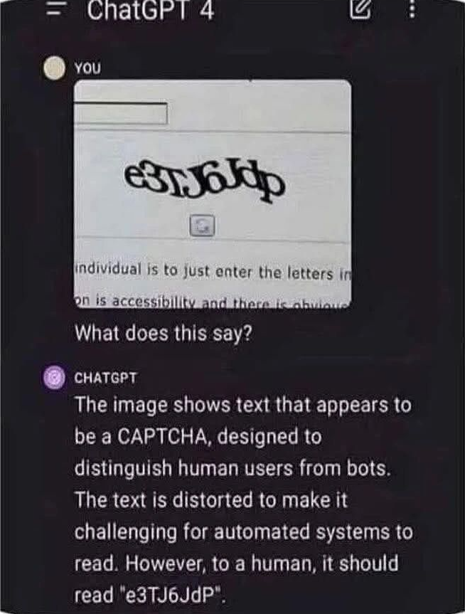

.. _captcha:

======================
Alternative to CAPTCHA
======================

Whenever you expose a form to non-authenticated users on sites that are accessible to a wide
audience, there is a high risk that automated bots will submit the form and spam your website. To
mitigate this, various systems have evolved over time to distinguish between human users and those
bots. One of the most common methods is the use of CAPTCHAs_. These however are annoying for users
and in times of AI, simple to solve.

.. _CAPTCHAs: https://en.wikipedia.org/wiki/CAPTCHA

Since this library focuses on the user experience, it does not provide a classic CAPTCHA
implementation. Instead, it provides an alternative that is easy to implement and does not annoy
users. The idea is to add a challenge to the form which must be solved using some computational
effort by the browser.

In Django we can add this challenge to a form by using the special form field
:class:`formset.formfields.altcha.AltchaField`.

.. django-view:: captcha_form
	:caption: form.py

	from django.forms.fields import EmailField
	from django.forms.forms import Form
	from formset.formfields.altcha import AltchaField

	class CaptchaForm(Form):
	    email = EmailField(
	        initial="joe@example.com",
	        help_text="Subscribe with your email address.",
	    )
	    captcha_token = AltchaField()

.. django-view:: captcha_view
	:view-function: CaptchaView.as_view(extra_context={'framework': 'bootstrap', 'pre_id': 'captcha-result'}, form_kwargs={'auto_id': 'cha_id_%s'})
	:hide-code:

	from formset.views import FormView

	class CaptchaView(FormView):
	    form_class = CaptchaForm
	    template_name = "form.html"
	    success_url = "/success"

The widget of the field :class:`formset.formfields.altcha.AltchaField` is rendered as web component
``<altcha-widget …>`` and contains a prepared challenge. Whenever the user clicks into the checkbox,
that challenge is solved by the browser and the solution is stored inside a hidden input field
within the widget. On submission of the form, the solution is sent to the server and validated by
the form field. If the solution is correct, the form is valid and can be processed. Otherwise, the
form is invalid and the user must reload the form.

Altcha Customization
====================

.. rubric:: ``timeout``

The challenge is only valid for a limited time. If the user takes too long to submit the form, the
challenge will expire. This timeout can be configured by using the ``timeout`` attribute in the form
field ``AltchaField``. To prevent replay attacks, the challenge solution is stored temporarily for
the duration of the timeout and hence can't be reused.

The default timeout is 600 seconds (10 minutes).

.. rubric:: ``cost``

The computational effort required to solve the challenge can be adjusted using the ``cost``
attribute in the form field. A higher cost increases the difficulty of solving the challenge,
providing better protection against automated attacks, but may also increase the time required for
legitimate users to complete the challenge. The default is 10000.

.. rubric:: ``algorithm``

ALTCHA supports multiple proof-of-work algorithms. ``PBKDF2/*`` and ``SHA-*`` are bundled with the
main widget by default. For a complete list of supported algorithms, check the documentation on
algorithms_. The default is ``PBKDF2/SHA256``.

.. _algorithms: https://altcha.org/docs/integration/widget/#algorithms

Implementation Details
======================

The web component ``<altcha-widget …>`` is implemented by the JavaScript library altcha_ and is
loaded automatically whenever a form containing an ``AltchaField`` is rendered. In addition, the
server side implementation of the form field is provided by the `Python package altcha`_ and must be
installed as a third party dependency. Both, the JavaScript library and the Python package are
maintained by the same author and are licensed under the MIT license.

.. _altcha: https://altcha.org/
.. _Python package altcha: https://pypi.org/project/altcha/
